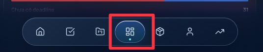

# UI Button — liquid glass navigation

Tài liệu tham chiếu cho nút điều hướng **đang chọn** trong thanh dưới trên mobile. Khi cần dùng lại kiểu này, lấy đúng nút, viền và lớp nền trong ảnh và code hiện tại; không tự thay màu hoặc độ sáng theo cảm tính.



## Vị trí nguồn

- Component: [MobileNav.tsx](../Dev/src/components/layouts/MobileNav.tsx) (`NavLink`, `mobile-nav-container`, `mobile-nav-mask`).
- Nền glass dùng chung: `.mobile-liquid-glass` trong [index.css](../Dev/src/index.css).
- Kiểu này hiện áp dụng ở mobile, viewport dưới `768px`. Ảnh trên là dark mode; light mode dùng các class cùng component.

## Cấu trúc và kích thước

- Thanh ngoài: pill bo tròn toàn bộ, `max-width: 440px`, cách hai mép màn hình `12px`, padding `6px`, cách đáy `16px + safe-area-inset-bottom`.
- Mỗi tab: vùng chạm cao `44px`, chia đều chiều rộng, bo tròn toàn bộ. Icon Lucide cỡ `20px`, nét `1.8`.
- Tab đang chọn có nền gradient, viền sáng mảnh, bóng trong nhẹ, bóng ngoài mềm và chấm nhỏ ở giữa sát đáy nút. Chấm chỉ hiện ở tab đang chọn.
- Các tab chưa chọn giữ nền trong suốt; không tạo viền hay nền nổi hàng loạt.
- Dùng trạng thái route thật (`NavLink.isActive`) để chọn nút. Giữ `aria-label`, `focus-visible` và hiệu ứng chuyển trạng thái `200ms`.

Class của nút đang chọn trong component hiện tại:

```tsx
const base = 'relative flex min-w-0 flex-1 h-11 items-center justify-center rounded-full transition-all duration-200 focus-visible:outline-2 focus-visible:outline-primary';
const active = 'bg-gradient-to-b from-blue-100/95 to-blue-200/70 text-blue-700 shadow-[inset_0_1px_0_rgba(255,255,255,.9),0_3px_10px_rgba(30,90,170,.18)] ring-1 ring-blue-300/80 dark:from-blue-500/35 dark:to-cyan-500/15 dark:!text-blue-100 dark:ring-blue-300/40';
const inactive = 'text-gray-600 dark:text-slate-300 hover:text-primary dark:hover:text-white';
```

## Light mode

**Thanh ngoài `.mobile-liquid-glass`:**

```css
background: linear-gradient(135deg, rgba(255,255,255,.88), rgba(226,239,255,.70));
border: 1px solid rgba(255,255,255,.88);
box-shadow: 0 12px 32px rgba(18,48,94,.16), inset 0 1px 0 rgba(255,255,255,.90);
backdrop-filter: blur(22px) saturate(170%);
```

**Nút đang chọn:** gradient `from-blue-100/95 to-blue-200/70`, icon `text-blue-700`, `ring-1 ring-blue-300/80`, bóng `inset 0 1px 0 rgba(255,255,255,.9), 0 3px 10px rgba(30,90,170,.18)`. Chấm `bg-blue-600`. Nút chưa chọn: `text-gray-600`; hover `text-primary`.

## Dark mode

**Thanh ngoài `.mobile-liquid-glass`:**

```css
background: linear-gradient(135deg, rgba(29,49,77,.78), rgba(9,23,47,.70));
border: 1px solid rgba(174,209,255,.24);
box-shadow: 0 14px 36px rgba(0,8,24,.36), inset 0 1px 0 rgba(215,235,255,.12);
backdrop-filter: blur(22px) saturate(170%);
```

**Nút đang chọn:** gradient `dark:from-blue-500/35 dark:to-cyan-500/15`, icon `dark:!text-blue-100`, `dark:ring-blue-300/40`, cùng bóng trong và bóng ngoài như light mode. Chấm `dark:bg-cyan-300`. Nút chưa chọn: `dark:text-slate-300`; hover `dark:hover:text-white`.

## Lớp blur phía sau thanh

`mobile-nav-mask` nằm dưới pill, phủ toàn chiều ngang và cao `120px + safe-area-inset-bottom`. Dùng `backdrop-filter: blur(32px) saturate(165%)`. Mask đậm ở vùng dưới pill rồi tan dần lên trên (`#000` đến 68%, trong suốt ở 100%). Light mode phủ xanh trắng mờ; dark mode phủ xanh đen mờ. Khi thanh ẩn, lớp blur cũng chuyển về `opacity: 0` cùng thời gian `420ms`.

## Cách dùng lại

1. Dùng hình dạng pill và class `.mobile-liquid-glass` cho **vỏ thanh**, không đặt nền đặc che hết hiệu ứng blur.
2. Dùng đúng cặp class active/inactive từ `MobileNav.tsx` cho **nút**. Viền và chấm active phải đi cùng nhau; chỉ một tab active tại một thời điểm.
3. Giữ icon và nhãn truy cập được. Nếu nút không đổi route, thay `NavLink.isActive` bằng trạng thái `aria-pressed` hoặc `aria-selected` thật.
4. Xem cả light và dark trên kích thước mobile trước khi tái sử dụng. Ảnh đính kèm là chuẩn tham chiếu dark mode; mã nguồn ở trên là chuẩn cho cả hai mode.
